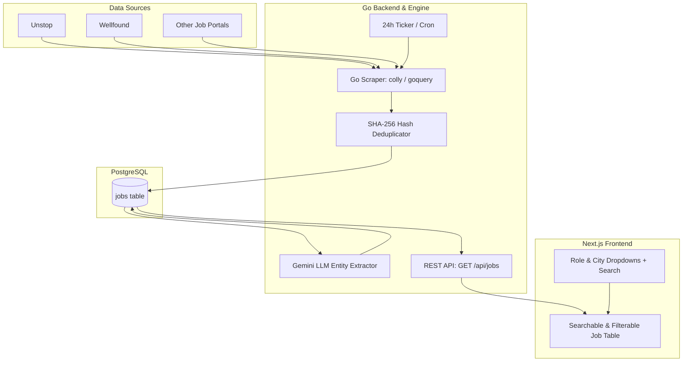
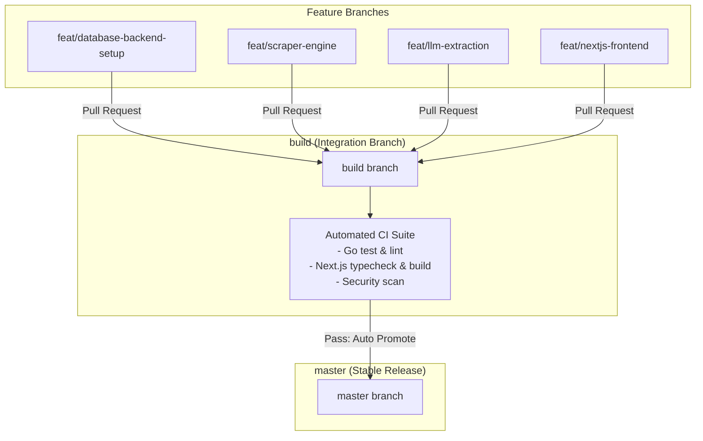

# 🚀 EventBeep

**Automated Job Board Aggregator for Fresher Jobs and Internships in India**

---

## 📌 Overview

EventBeep is a decoupled, automated job aggregation platform specifically tailored for students and fresh graduates in India. It crawls job listings from multiple sources, eliminates duplicates using cryptographic hashing, extracts clean semantic entities (`role`, `city`) using Gemini LLM, and presents opportunities in a high-performance Next.js interface.

### Key Capabilities
- ⚡ **Decoupled Architecture**: High-throughput Go REST backend paired with a modern Next.js frontend.
- 🗄️ **Robust Data Store**: PostgreSQL database with UUID keys, connection pooling, and indexed filtering.
- 🕷️ **Scraper Engine**: Go-based scraper module (`goquery` / `colly`) targeting major job portals (Unstop, Wellfound).
- 🔒 **SHA-256 Deduplication**: Uniqueness key generated via `SHA-256(lowercase(company + title))` prevents duplicate job posts.
- 🧠 **LLM Enrichment**: Automated extraction of normalized role and city using Google Gemini API.
- ⏰ **Automated Synchronization**: Background ticker / cron job scheduled every 24 hours.
- 💻 **Interactive UI**: Responsive, accessible table with debounced search, city/role filters, and instant pagination.

---

## 🏗️ System Architecture

---

## 🔄 The GitHub Flow ("God Flow")

EventBeep enforces a strict three-tier branch management strategy:

### Branch Rules:
1. All feature and bugfix branches originate from **`build`** and submit PRs to **`build`**.
2. **`build`** automatically runs the full CI test suite.
3. Upon green CI, `.github/workflows/promote-to-master.yml` promotes `build` into **`master`**.
4. **Never delete any branch**: Every branch is preserved in Git history permanently.

---

## 🚀 Execution Phases

- [x] **Phase 1: Database & Go Backend Setup** (Completed & Integrated)
  - PostgreSQL schema (`jobs` table with UUID, hash_key, title, company, role, city, source_url, created_at).
  - Go connection pool and REST endpoint `GET /api/jobs` with pagination and filtering.
- [x] **Phase 2: The Scraper Engine (Go)** (Completed & Integrated)
  - Web scraper module using `goquery` for Unstop, Wellfound, and Internshala.
  - SHA-256 hash deduplication on `lowercase(company_name + job_title)` with idempotent database insertion.
- [x] **Phase 3: LLM Integration (Go)** (Completed & Integrated)
  - Gemini API integration with structured JSON extraction and resilient heuristic fallback.
  - 24-hour background ticker/cron pipeline orchestrating scrape, dedup, enrich, and store.
- [x] **Phase 4: Next.js Frontend** (Completed & Integrated)
  - Next.js 16 + Tailwind CSS 4 UI with debounced search, city/role dropdown filters, responsive table/cards, loading skeletons, and Go API client.

---

## 🤖 Dedicated Agent Team

This repository is governed by **EventBeep CTO** orchestrating specialized domain leads:
- **`EventBeep CTO`** (`agent-e1edae47-b8a1-4fbc-b552-1f4a5a506f5f`): Technical Director & Architect. Manages the roadmap, orchestrates team leads, enforces phase gates (Phases 1-4), and approves integration into `build`.
- **`EventBeep Backend Lead`** (`agent-a802070d-a848-4289-ae32-92e544a82172`): Database schema, Go REST API, pagination & query filtering.
- **`EventBeep Pipeline Lead`** (`agent-f6eb04e4-c68c-4588-be73-18e37f971ecf`): Web scraper engine, deduplication, Gemini LLM enrichment, and 24h cron scheduling.
- **`EventBeep Frontend Lead`** (`agent-96f6e317-92ba-474f-905e-74d8879872c0`): Next.js frontend, Tailwind CSS, search and filter components.

---

## 📄 License

This project is licensed under the [MIT License](LICENSE).
